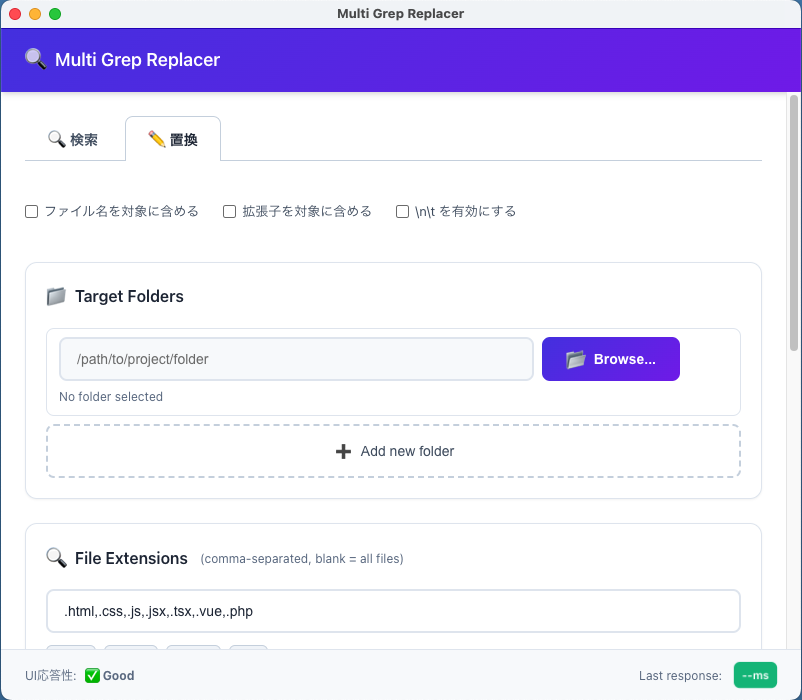

# Multi Grep Replacer v1.1.2



[](https://github.com/sarap422/electron-multi-grep-replacer/releases)
[](LICENSE)
[]()
[]()

---

## About

**Description**:
複数フォルダ内のファイルに対して、複数の検索・置換ルールを一括で実行するデスクトップアプリです。

**Website**:
https://code-plus.jp/gp/multi-grep-replacer-8480/

**Topics**:
batch-processing, cross-platform, developer-tools, electron, find-and-replace, grep, javascript, macos, text-replacement, windows

---

## 主な機能

- **複数ルールの一括置換:** ルールを上から順に適用します。To を空にすると一致箇所を削除できます
- **検索（Grep）:** ファイルを変更せずに内容を検索し、`パス:行:列` の形式で結果を表示します
- **複数フォルダ対応:** サブフォルダまで検索します。拡張子で絞り込めます
- **ファイル名・拡張子の置換:** オプションで、内容に加えてファイル名も対象にできます
- **改行・タブの指定:** オプションで、`\n` `\t` `\r` `\\` を解釈します
- **設定の保存:** ルールや対象フォルダをJSONで保存、読み込みできます
- **結果の出力:** 結果をコピーしたり、CSVで保存したりできます
- **実行の制御:** 実行中に一時停止と停止ができます。処理済みの変更は残ります

## インストール

[Releases](https://github.com/sarap422/electron-multi-grep-replacer/releases) からダウンロードしてください。

| OS | ファイル | 対応環境 |
|---|---|---|
| macOS | `MultiGrepReplacer-<version>.dmg` | macOS 10.14以降（Intel / Apple Silicon） |
| Windows | `MultiGrepReplacer-Setup-<version>.exe` | Windows 10以降（x64） |

macOS版は署名していません。初回はアプリを右クリックして「開く」を選んでください。

## 使い方

1. **検索** か **置換** のタブを選びます
2. 対象フォルダを選びます
3. 対象の拡張子を入力します（例: `.html,.css,.js`）。空欄なら全ファイルが対象です
4. ルールの From と To を入力します
5. 実行します。置換では確認ダイアログが表示されます

**置換は元に戻せません。** 実行前にコミットするか、バックアップを取ってください。

### 例: CSSファイルの参照とファイル名をまとめて変更する

「ファイル名を対象に含める」と「拡張子を対象に含める」をオンにして、次のルールを実行します。

```
From: ly-single4efA.css
To:   ly-single4vnA.css
```

ファイル内の参照が置き換わり、`ly-single4efA.css` というファイル自体の名前も変わります。

## オプション

| オプション | 対象 |
|---|---|
| ファイル名を対象に含める | 拡張子を除いた名前（`foo.html` の `foo`） |
| 拡張子を対象に含める | ドットを含む拡張子（`foo.html` の `.html`） |
| 両方オン | ファイル名全体（`foo.html`） |
| `\n\t` を有効にする | From/To の `\n`（改行）、`\t`（タブ）、`\r`（CR）、`\\`（バックスラッシュ） |

ファイル名の変更では、既存のファイルを上書きしません。同名のファイルがある場合や、使えない文字を含む場合は変更せず、結果に ❌ で表示します。フォルダ名は変更しません。

## 制限事項

- 検索はリテラル文字列の一致で、正規表現は使えません
- 大文字と小文字は区別します
- 文字コードはUTF-8のみです
- 100MBを超えるファイルは対象外です
- `node_modules`、`.git`、`dist`、`build` は対象外です

## 開発

Node.js が必要です。

```bash
git clone https://github.com/sarap422/electron-multi-grep-replacer.git
cd electron-multi-grep-replacer
npm install
npm start
```

```bash
npm test             # テスト
npm run test:syntax  # 構文チェック
npm run build:mac    # macOS版のビルド
npm run build:win    # Windows版のビルド
```

dmgのビルドには PATH 上の `python` が必要です。詳しくは [開発/テスト方針](docs/03_development-workflow.md) を参照してください。

## ドキュメント

- [要件定義書](docs/01_requirements.md)
- [システム設計書](docs/02_architecture.md)
- [開発/テスト方針](docs/03_development-workflow.md)
- [開発タスク](docs/04_tasks.md)

## ライセンス

[MIT License](LICENSE)
